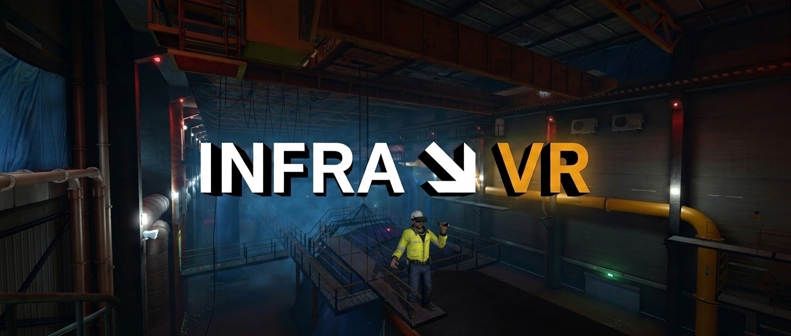

<p align="center">
  
</p>

# INFRA VR — Native 6DOF OpenVR & Vulkan Mod for INFRA

<p>
  
  
  
  <a href="https://www.youtube.com/watch?v=UdWe6QkaFRY"></a>
</p>

> **License Note:** Mod code is licensed under the **[MIT License](LICENSE)**. Included Valve Source SDK headers in [`InfraVR/sdk/`](InfraVR/sdk/) are governed by the **Valve Source 1 SDK Non-Commercial License** ([`InfraVR/sdk/LICENSE.txt`](InfraVR/sdk/LICENSE.txt), [`thirdpartylegalnotices.txt`](InfraVR/sdk/thirdpartylegalnotices.txt)).

**INFRA VR** adds full 6DOF OpenVR support to **[INFRA](https://store.steampowered.com/app/251110/INFRA/)** via a standalone drop-in `d3d9.dll` proxy (customized **[DXVK](https://github.com/doitsujin/dxvk)** D3D9-to-Vulkan backend, built on **[Portal 2 VR](https://github.com/Gistix/portal2vr)** and **[Left 4 Dead 2 VR](https://github.com/sd805/l4d2vr)**) without modifying game executables or VPK archives.

> [!WARNING]
> ### Early Release / Work in Progress Disclaimer (`v0.1.0`)
> * **Early State:** Not every map, puzzle, or edge case across INFRA's 10 chapters has been exhaustively tested yet. Please report bugs via **[GitHub Issues](https://github.com/1mannlan/Infra-VR/issues)**.
> * **Untested Non-Index Controllers:** Hardware testing so far was **only performed on Valve Index ("Knuckles")**. Controllers without finger tracking (Meta Quest / Oculus Touch, HTC Vive Wand, Vive Cosmos, WMR, HP Reverb G2, Pico) are supported by design (1:1 Grip-button grabbing + button-driven finger animation), **but untested on hardware** — feedback is expressly requested!
> * **Grip Calibration Notice:** Pre-calibrated hand/tool offsets in [`dist/VR/controller_profiles.txt`](dist/VR/controller_profiles.txt) currently only exist for **Valve Index (`[knuckles]`)**. Other controllers require a one-time **in-game calibration** (`L3 + R3` hold 0.8s); calibrated `RightHand*` / `LeftHand*` offsets from `VR/config.txt` are very welcome via **Pull Request**!

---

## Trailer

<p align="center">
  <a href="https://www.youtube.com/watch?v=UdWe6QkaFRY">
    
  </a>
</p>
<p align="center">
  <a href="https://www.youtube.com/watch?v=UdWe6QkaFRY"><strong>Watch the INFRA VR Trailer on YouTube</strong></a>
</p>

---

## Key Features

* **6DOF Stereoscopic Vulkan Rendering & MSAA:** Translates Source Engine D3D9 to Vulkan with full-resolution MSAA stereo targets up to **8x MSAA** (`AntiAliasing=0|2|4|8`; eye dimensions clamped to `3584 px` max to stay within Source's `4096×4096` `_rt_FullFrameFB` limit) and optional `VRAMOffload=true` (evicts `D3DPOOL_MANAGED` shadow copies from 32-bit RAM to prevent *Out of Memory* crashes).
* **Physical Waist Belt Holster & Single-Cell Battery Inventory:** Neck/torso-anchored waist belt with 1:1 yaw rotation and pitch-locked height stability (stays fixed vertically when looking down), plus optional wrist slots (`BatteryInventoryMode=belt|wrist|both|off`). Physically draw and holster the **Flashlight** (left hip) and **DSLR Camera** (right hip, angled with the LCD facing up and lens down) directly on the belt with equip/holster animations suppressed and accidental re-holster guards. Grab single round **D** or **AA** battery cells from upright `STALENERGY` belt packs (with subtle Flashlight/Camera icon reserve badges) and touch them to your Flashlight or Camera to reload instantly; releasing a cell anywhere safely returns it to reserve (loss protection).
* **Dual-Hand 6DOF Gear, SuperFlashlight Boost, Camera LCD Zoom, Grip Flip & Tail-Cap LED Ring:** Independent **Flashlight** / **SuperFlashlight** on the left hand (with front lens glow when active, belt holster support, and **High-Beam Boost** by holding Left Trigger `≥ 1.0s` with the SuperFlashlight) and **DSLR Camera** on the right hand with an aspect-corrected, wide-angle live `_rt_CameraWeapon` LCD viewfinder supporting smooth **`1.0×`–`3.0×` LCD zoom** (**Right Trackpad Up/Down** slide/press with tactile haptic detents, or **X / Left A** single-button step toggle `1.0× → 1.6× → 2.5×`). Flip the flashlight between standard underhand and overhand/hanging grip via **Left Trackpad Swipe Up** (or automatically matched to your hand orientation when drawn from the belt), including a natural 15° downward beam pitch in overhand mode. Features a diegetic 24-segment recessed LED battery-level ring on the standard flashlight tail cap (`ShowFlashlightBatteryRing`) and keeps the flashlight equipped and visible while reading and closing documents.
* **3-Mode Physical Camera Flash & Self-Blinding:** Switch between **Auto** (default, bolt + `A`), **On** (bolt), and **Off** (crossed-out bolt) via a short **R3** tap, displayed live on the camera LCD using updated `INFRAicons.vfont` icons. A physical xenon flash burst combines dynamic projected lighting and DLight illumination with directional self-blinding glare & retinal afterimage when firing the flash into your own eyes (`CameraFlashBlindingStrength`).
* **5-Finger Skeletal Hands, Smartphone Touch & Impact Haptics:** Drives INFRA's articulated hand viewmodels (`v_camera.mdl`, `v_light.mdl`, `v_superlight.mdl`, `v_phone.mdl`) via OpenVR Skeletal Input with an anatomically mirrored left-hand rig, opaque black interior wrist cuff (eliminating see-through wrist openings), calibrated matte skin shading (`player_hands.vmt`), surface finger conformation & physical world/object palm collision, velocity-scaled palm/fingertip touch haptics, and direct finger-tap interaction on the 3D Smartphone Pause Menu.
* **VR Physics Grabbing & Interaction:** Hold-to-grab via Left/Right Grip (plus close-contact Index finger curl), 1:1 in-hand `CGrabController` hold with finger curl clamping, hand-to-hand transfer, open-hand physics pushing, velocity-scaled impact haptics on buttons, doors, and physics props, tunable fingertip switch reach (`UseTipDistance`, `UseTouchRadius`), and hand-based selection highlight.
* **Diegetic 3D Menus & Multi-Language Legibility:** Full thumbstick cursor, trigger, and smartphone finger-tap support for the **Main Menu Laptop**, **Options Binder**, **Chapter Projector**, **Smartphone Pause Menu**, and in-world **PCs / Keypads**. Preserves the original white-on-black / black-on-white menu styling with sharper `SourceSansPro` fonts and automatic `Arial` fallback across all languages.
* **3D Spatial Audio (Steam Audio HRTF & Wall Occlusion):** Native **Steam Audio 4.8.1** (`phonon.dll`) binaural 3D HRTF with vertical elevation, raycast wall occlusion (`SpatialAudioOcclusion`), Source room reverb send (`SpatialAudioRoomSend`), character lip-sync preservation, and live HMD-synced `AudioState` across gameplay, seated intro/car cutscenes, and 3D menus — plus optional **DSOAL (OpenAL Soft)** and `native` fallback modes.
* **VR Performance, Stability & Comfort:** Per-frame camera/HUD reuse across both eyes, paired per-eye shadow depth passes, 6DOF roomscale collision-hull sync, expanded `materialsystem.dll` stereo render stack budgets, screen-space post-process bypass (`mat_postprocess_enable 0`), head-in-wall fade, seated Chapter 1 intro & Chapter 2 car eye-height tuning (`IntroSeatHeight`, `CarSeatHeight`), background focus keeping, and stability fixes for savegame loading / `mat_texture_list`.
* **Live Calibration & Config Hot-Reload:** Adjust 6DOF hand position/rotation offsets inside VR and hot-reload `VR/config.txt`.

---

## Installation (Ready-to-Use Release)

### Option A: Automatic Installer (Recommended)
1. Ensure **INFRA**, **SteamVR**, and the **[Microsoft Visual C++ 2015–2022 Redistributable (x86)](https://aka.ms/vs/17/release/vc_redist.x86.exe)** are installed.
2. Download the latest **`Infra-VR-v0.1.0.zip`** from **[Releases](https://github.com/1mannlan/Infra-VR/releases)** and extract it anywhere (or use [`dist/`](dist/) if cloning from source).
3. Run **`install_vr.bat`** (or **`start_infra_vr.bat`** to install and immediately launch INFRA in VR).
   * Automatically detects your INFRA folder and backs up any existing non-VR `bin/d3d9.dll` to `bin/d3d9.dll.bak`.
4. Run **`uninstall_vr.bat`** anytime to restore standard desktop mode.

### Option B: Manual Installation
Copy [`dist/`](dist/) into your `<INFRA>` game folder (e.g., `C:\Program Files (x86)\Steam\steamapps\common\infra\`):
* `dist/bin/d3d9.dll` → `<INFRA>/bin/d3d9.dll` *(and `<INFRA>/infra/bin/d3d9.dll` if present)*
* `dist/bin/openvr_api.dll` → `<INFRA>/bin/openvr_api.dll`
* `dist/bin/phonon.dll` → `<INFRA>/bin/phonon.dll` *(and `<INFRA>/phonon.dll` — required for `SpatialAudioMode=steam_audio`)*
* `dist/dsoal/*` → `<INFRA>/*` *(optional — only if using `SpatialAudioMode=dsoal`)*
* `dist/VR/*` → `<INFRA>/VR/*`
* `dist/infra/materials/*` → `<INFRA>/infra/materials/*` *(`vgui/`, `vr/`, and `models/characters/player_hands.vmt`)*
* `dist/infra/models/vr/*` → `<INFRA>/infra/models/vr/*` *(single-cell D & AA battery models)*
* `dist/infra/resource/*` → `<INFRA>/infra/resource/*` *(`MenuScheme.res`, `CameraScheme.res`)*
* `dist/infra/vgui/fonts/INFRAicons.vfont` → `<INFRA>/infra/vgui/fonts/INFRAicons.vfont` **and** `<INFRA>/platform/vgui/fonts/INFRAicons.vfont` *(camera flash Auto/On/Off LCD icons)*

Start **SteamVR**, then launch `infra.exe` with:
```text
-novid -windowed -w 1280 -h 720 +mat_queue_mode 0 +engine_no_focus_sleep 0
```
*(Starts on `mat_queue_mode 0` so VR eye render targets initialize safely on the main thread, then switches to multi-threaded `mat_queue_mode 2` once in VR when `MultiThreadedRendering=true`.)*

---

## VR Controls

Default bindings are included for **Meta Quest / Oculus Touch**, **Valve Index (Knuckles)**, **HTC Vive Wand**, **HTC Vive Cosmos**, **Windows Mixed Reality**, and **HP Reverb G2**:

| Action | Left Controller (Flashlight & Movement) | Right Controller (Camera & Interaction) |
| :--- | :--- | :--- |
| **Move / Strafe** | Left Thumbstick | — |
| **Sprint (Toggle)** | Left Thumbstick Click | — |
| **Turn (Smooth or Snap)** | — | Right Thumbstick Left / Right |
| **Jump** | — | **Right Thumbstick Up** |
| **Crouch (Toggle)** | — | **Right Thumbstick Down** |
| **Interact (`+use`) / Hold Physics Prop** | **Left Grip** *(Hold to grab, release to drop)* | **Right Grip** *(Hold to grab, release to drop; Valve Index also supports close-contact finger curl)* |
| **Draw / Holster Gear (Waist Belt)** | Left Hip + **Left Grip** *(Flashlight)* | Right Hip + **Right Grip** *(Camera)* |
| **Physical Battery Reload (Belt / Wrist)** | Grab **D** battery pack cell with **Grip** → touch Flashlight *(release anywhere to return)* | Grab **AA** battery pack cell with **Grip** → touch Camera *(release anywhere to return)* |
| **UI Click / Take Photo (when Camera raised)** | — | **Right Trigger** *(menus also confirm with **A**)* |
| **Equip / Holster DSLR Camera** | — | **A** Button *(also Menu Confirm in menus)* |
| **Cycle Camera Flash Mode (`Auto` / `On` / `Off`)** | — | **Right Thumbstick Click (`R3`, short tap)** *(while Camera is equipped)* |
| **Camera LCD Zoom (`1.0×`–`3.0×`)** | **X** Button *(Index: Left A — optional single-button step toggle `1.0× → 1.6× → 2.5×`)* | **Right Trackpad Slide / Press Up & Down** *(smooth `1.0×`–`3.0×` zoom with haptic detents; resets to wide-angle on holster)* |
| **Smartphone Pause Menu / Back** | — | **B** Button *(supports direct finger-tap on the 3D phone screen)* |
| **Toggle Flashlight Beam / SuperFlashlight Boost** | **Left Trigger** *(tap: On/Off; hold `≥ 1.0s` with SuperFlashlight: High-Beam Boost)* | — |
| **Flip Flashlight Grip (Underhand ↔ Overhand)** | **Left Trackpad Swipe Up** *(also auto-matches hand orientation from belt)* | — |
| **Equip / Holster Flashlight** | **Y** Button *(Index: Left B)* | — |
| **Quick Reload Battery *(Optional)*** | Left Trackpad Swipe Down *(or hold Y/Left B 0.45s; off by default)* | Right Trackpad Swipe Down *(or hold A 0.45s; off by default)* |
| **Recenter VR Origin** | **Short tap L3 + R3** | **Short tap L3 + R3** |

> *Controller Notes:* On **HTC Vive Wands** and **Windows Mixed Reality**, **Trackpad Click** and **Application Menu** handle Equip Camera / Zoom / Flashlight / Pause. Quick-reload gestures (Trackpad Swipe Down, Trackpad Click on Index, or holding **A** / **Y** for `0.45s`) only apply when `AllowQuickReload=true` or `BatteryInventoryMode=off`.

### Belt Holster & Physical Battery Reload
With `BeltHolsterEnabled=true` and `BatteryInventoryMode=belt` (both default), INFRA VR attaches an interactive waist belt anchored below your head with 1:1 horizontal yaw rotation and pitch-locked height:
1. **Draw & Holster Gear:** Reach to your **left hip** (Flashlight) or **right hip** (DSLR Camera) and press **Grip** to draw it; while holding the tool, move it back over the empty belt ring, wait briefly for the highlight, and release **Grip** to holster it.
2. **Automatic / Manual Flashlight Flip:** Drawing the flashlight from the belt automatically selects underhand or overhand/hanging grip to match your hand orientation (or swipe **Left Trackpad Up** anytime while equipped). In overhand mode, the beam tilts **15° downward** for relaxed hanging aim.
3. **Single-Cell Battery Reloading:** Reach to the `STALENERGY` **D** (Flashlight) or **AA** (Camera) pack on your belt (or optional wrist slot) and hold **Grip** to pick up a single round battery cell, then bring it to your equipped Flashlight or Camera to reload instantly. Releasing the cell anywhere else safely returns it to reserve without losing a battery.
4. **Height & Inseam Belt Sizing:** Adjust vertical belt placement via `PlayerHeight`, `PlayerInseam`, and `BeltHeightOffsetCm` in `VR/config.txt` (accepts `cm`, `in`/`"`, `ft'in"`, or `m`; e.g., `175cm`, `69in`, `5'9"`), or **hold your controller at your desired hip/belt height in Calibration Mode (`L3 + R3` 0.8s) and pull Trigger** to set the belt `1.5 cm` above that calibrated controller height (independent of SteamVR floor calibration; default `82 cm` / `32.3 in`).

### Live In-Headset Hand Calibration Mode
For non-Index controllers (or fine-tuning the DSLR camera / flashlight grip) and direct waist-belt height calibration:
1. **Hold L3 + R3 for 0.8 seconds** in-game to toggle **Calibration Mode** *(haptic pulse; a short tap of `L3 + R3` recenters instead)*.
2. Release Grip first, then **hold Right Grip** (Camera) or **Left Grip** (Flashlight) for `>= 0.25s` — the hand/tool freezes in world space while you move and rotate your real hand into your natural grip.
3. **Release Grip** to save to `VR/config.txt` and auto-exit Calibration Mode *(or hold a controller at hip height and pull either **Trigger** to set `BeltHeightOffsetCm` `1.5 cm` above the controller — falling back to SteamVR height if held near eye level; hold `L3 + R3` 0.8s again to cancel)*.

---

## Configuration (`VR/config.txt`)

`VR/config.txt` is hot-reloaded whenever changes are saved:

| Setting | Default | Description |
| :--- | :--- | :--- |
| `TurnSpeed` | `0.15` | Smooth turning speed (`0.0`–`1.0`). |
| `SnapTurning` | `false` | Enable discrete snap turning instead of smooth turning. |
| `SnapTurnAngle` | `45.0` | Angle in degrees per snap turn (`30.0`, `45.0`, `90.0`). |
| `LeftHanded` | `false` | Left-handed weapon/flashlight swap *(Experimental)*. |
| `VRScale` | `43.2` | World scale in Source units per meter (clamped `5.0`–`200.0`). |
| `IPDScale` | `1.0` | Interpupillary distance multiplier. |
| `RenderScale` | `1.0` | SteamVR eye resolution multiplier (`0.4`–`2.0`; eye dimensions clamped to `3584 px` max for Source's `4096×4096` render-target limit; requires restart). |
| `AntiAliasing` | `4` | MSAA sample count for VR eye buffers (`0`, `2`, `4`, `8`; `8` recommended on capable GPUs for sharp menus/edges; requires restart). |
| `RenderWindow` | `0` | `0` = desktop mirror disabled (faster), `1` = mirror left eye to desktop window. |
| `ShowHands` | `true` | Render 5-finger skeletal VR hands & physical hand collision. |
| `UseTipDistance` | `9.0` | Virtual fingertip distance in front of the controller for selecting switches (cm). |
| `UseTouchRadius` | `15.0` | Maximum fingertip-to-object radius for close-range switch/prop selection (cm). |
| `AimMode` | `2` | `0` = None, `1` = 2D Crosshair, `2` = Hide 2D crosshair (context/menu cursor). |
| `MenuSeatHeight` | `23.5` | Main menu eye height offset above the laptop camera (cm). |
| `MenuSeatForward` | `0.0` | Main menu forward/back seat offset toward the laptop (cm). |
| `IntroSeatHeight` | `5.0` | Chapter 1 intro chair eye height offset (cm), aligned with Main Menu height. |
| `CarSeatHeight` | `15.0` | Chapter 2 intro car eye height offset (cm). |
| `SpatialAudioMode` | `steam_audio` | `steam_audio` (native 3D HRTF + height + occlusion), `dsoal` (OpenAL Soft HRTF, restart required), or `native` (Source stereo/headphones). |
| `SpatialAudioOcclusion` | `true` | Enable raycast wall occlusion in `steam_audio` mode. |
| `SpatialAudioRoomSend` | `1.0` | Source room reverb send multiplier (`0.0`–`1.5`) in `steam_audio` mode. |
| `BatteryInventoryMode` | `belt` | Reserve battery slot placement: `belt`, `wrist`, `both`, or `off`. |
| `BeltHolsterEnabled` | `true` | Enable drawing & holstering the Flashlight and Camera on the waist belt. |
| `PlayerHeight` | `0` | Standing height (`0` = unset; accepts `cm`, `in`/`inch`, `ft'in"`, `m`, e.g. `175cm`, `69in`, `5'9"`). |
| `PlayerInseam` | `0` | Optional inner leg length / inseam (`cm` or `in`, e.g. `78cm` or `30.7in`) to refine waist-belt drop. |
| `MeasurePlayerHeight` | `false` | Set `true` in `VR/config.txt` while standing upright to measure your eye/body height once from SteamVR and auto-reset to `false`. |
| `BeltHeightOffsetCm` | `auto` | Belt drop below eyes (`10.0`–`130.0 cm`; accepts `cm`/`in`, or set via **Controller at belt + Trigger** in Calibration Mode = `1.5 cm` above controller). When `auto`: uses `0.936 * H - I - 1.5 cm` (or SteamVR eye height if measured) when both `PlayerHeight` (`H`) and `PlayerInseam` (`I`) are set, `0.480 * H` from height alone, `I` from inseam alone, or `82.0 cm` (`32.3 in`) default (`1 in = 2.54 cm`, `1 cm = 0.3937 in`). |
| `ShowBatteryCounts` | `true` | Show subtle reserve battery count badges with Flashlight/Camera icons on belt/wrist packs. |
| `AllowQuickReload` | `false` | Allow legacy Trackpad Swipe Down or `0.45s` button-hold quick reload while belt/wrist inventory is active. |
| `ShowFlashlightBatteryRing` | `true` | Render the 24-segment recessed LED battery-level ring on the flashlight tail cap. |
| `CameraFlashBlindingStrength` | `1.0` | Multiplier for directional camera flash self-blinding glare & retinal afterimage (`0.0`–`2.0`). |
| `MultiThreadedRendering` | `true` | Use `mat_queue_mode 2` multi-threaded rendering (`false` forces `mat_queue_mode 0`). |
| `KeepActiveInBackground` | `true` | Keep INFRA unthrottled with audio active when desktop mirror loses focus. |
| `VRAMOffload` | `true` | Evict `D3DPOOL_MANAGED` world/model textures from 32-bit RAM after VRAM upload (requires restart). |
| `DebugFingerLog` | `false` | Diagnostics only: write skeletal finger telemetry to `VR/finger_debug.txt`. |
| `EnableProfilerHotkey` | `false` | Enable `F12` 10s CPU frame profiler hotkey (`VR/profile_*.txt`). |
| `DesktopWindowWidth` / `Height` | `1280` / `720` | Resolution of the desktop mirror window (`640..3840` × `480..2160`). |

Controller-specific defaults (`knuckles`, `oculus_touch`, `vive_controller`, `vive_cosmos_controller`, `holographic_controller`, `hpmotioncontroller`, `default`) live in [`dist/VR/controller_profiles.txt`](dist/VR/controller_profiles.txt).

---

## Building from Source

Self-contained repository (includes customized DXVK, MinHook, OpenVR SDK 2.5.1, Steam Audio SDK 4.8.1, and Source SDK 2013 headers — no submodules, Meson, or MinGW needed).

### Prerequisites
* **Windows 10 / 11 (64-bit)**
* **Visual Studio 2022 / 2026** (or Build Tools) with **"Desktop development with C++"**, **MSVC v143 or v145 x86/x64**, and **Windows 10/11 SDK** *(selects `v143` if installed, else `v145`)*.

### Build Options
* **One-Click Script:** Run [`build.bat`](build.bat) from the repo root (locates `MSBuild.exe`, builds `InfraVR.sln` `Release|x86`, copies to `dist/bin/d3d9.dll`).
* **Visual Studio IDE:** Open [`InfraVR.sln`](InfraVR.sln), select **`Release | x86` (`Win32`)**, build (**`Ctrl+Shift+B`**), and copy `Release/d3d9.dll` to `dist/bin/d3d9.dll`.
* **Command Line (PowerShell):**
  ```powershell
  $msbuild = & "${env:ProgramFiles(x86)}\Microsoft Visual Studio\Installer\vswhere.exe" -products * -latest -find "MSBuild\**\Bin\MSBuild.exe" | Select-Object -First 1
  & $msbuild "InfraVR.sln" /p:Configuration=Release /p:Platform=x86 /m /v:minimal
  Copy-Item "Release\d3d9.dll" "dist\bin\d3d9.dll" -Force
  ```

---

## Repository Structure

```text
Infra-VR/
├── build.bat                     # Automated MSBuild Release|x86 build script
├── package_release.bat           # Packages dist/ + docs/licenses into dist/Infra-VR-v0.1.0.zip
├── InfraVR.sln                   # Visual Studio Solution (Release|x86 & Debug|x86)
├── InfraVR/                      # INFRA VR Mod Source Code
│   ├── dllmain.cpp               # DLL entry point & windowed video.txt setup
│   ├── game.cpp / game.h         # Source Engine interface discovery
│   ├── hooks.cpp / hooks.h       # MinHook detours (dRenderView, 6DOF gear, 3D VGUI, spatial audio)
│   ├── vr.cpp / vr.h             # OpenVR init, stereo matrices, action input, calibration, 360° VR intro, config hot-reload
│   ├── vr_audio.cpp / .h         # Native Steam Audio 3D HRTF spatializer, wall occlusion & lip-sync preservation
│   ├── vr_camera_flash.cpp / .h  # 3-mode camera flash, xenon burst & directional self-blinding glare
│   ├── vr_grab.cpp / .h          # Dual-hand Hold-to-Grab, CGrabController 1:1 hold, open-hand swatting
│   ├── vr_hands.cpp / .h         # 5-finger OpenVR skeletal solver, viewmodel rigging & palm collision
│   ├── vr_inventory.cpp / .h     # Waist belt holster, wrist slots, single-cell battery reload & tail-cap LED ring
│   ├── vr_memstack_patch.h       # Expands materialsystem.dll per-frame stereo render stack budgets
│   ├── vr_viewmodel_depth.cpp/.h # Viewmodel depth/stencil helpers for 3D VR hands & held items
│   ├── vr_profiler.h             # Lightweight F12 CPU frame timing profiler
│   ├── offsets.h / sigscanner.h  # INFRA binary signatures & offsets
│   └── sdk/                      # Valve Source SDK 2013 headers (LICENSE.txt, thirdpartylegalnotices.txt)
├── dxvk/                         # Customized DXVK D3D9-to-Vulkan backend with OpenVR submission
├── thirdparty/
│   ├── minhook/                  # MinHook x86/x64 hooking library (BSD 2-Clause)
│   ├── openvr/                   # Valve OpenVR SDK 2.5.1 (BSD 3-Clause)
│   └── steamaudio/               # Valve Steam Audio SDK 4.8.1 (Apache 2.0)
├── dist/                         # Standalone Release Package (install_vr.bat, start_infra_vr.bat, uninstall_vr.bat, bin/ incl. phonon.dll, dsoal/, VR/ incl. 360° intro assets, infra/ materials/models/resource/fonts)
├── LICENSE                       # Project License (MIT) & Source SDK Notice
└── THIRD_PARTY_LICENSES.md       # Full license texts & attributions
```

---

## Troubleshooting

* **INFRA opens in a flat 2D theater screen instead of VR:**
  * Start **SteamVR** before launching INFRA (or use [`dist/start_infra_vr.bat`](dist/start_infra_vr.bat)).
  * In Steam: right-click **INFRA** → **Properties** → **General** → uncheck *"Use Desktop Game Theatre while SteamVR is active"*.
* **Shader compilation stutter on first load:**
  * In Steam: **Settings** → **Shader Pre-Caching** → enable *"Allow background processing of Vulkan shaders"*.
* **Camera or flashlight angle feels off:**
  * Hold **L3 + R3 for 0.8s** in-game to run **Calibration Mode**, hold Grip to align the tool naturally, and release to save to `VR/config.txt`.
* **Waist belt sits too high or too low:**
  * Hold a controller at your comfortable hip/belt height, enter **Calibration Mode** (`L3 + R3` `0.8s`), and pull **Trigger** to set `BeltHeightOffsetCm` `1.5 cm` above that hand position (floor-independent), set `PlayerHeight` / `PlayerInseam` (e.g. `175cm` / `78cm` or `69in` / `30.7in`), or set an explicit `BeltHeightOffsetCm` (`auto` = `82.0 cm` / `32.3 in` default, range `10.0`–`130.0 cm`); changes hot-reload live in-game.
* **Prefer quick button/swipe battery reload instead of belt pickup:**
  * Set `AllowQuickReload=true` (keep belt/wrist active) or `BatteryInventoryMode=off` in `VR/config.txt`.
* **Blurry main menu text or shimmering thin geometry:**
  * Set `AntiAliasing=8` in `VR/config.txt` and restart the game for cleaner 8x MSAA edges (note that VR eye render targets cap at `3584 px` max dimension to fit Source's `4096×4096` render-target limit).

---

## Contributing

Contributions and bug reports are welcome:
1. **Controller Grip Profiles (`VR/controller_profiles.txt`):** Calibrated `RightHand*` / `LeftHand*` offsets from `VR/config.txt` for non-Index controllers are very welcome via **Pull Request**.
2. **Map-Specific Bug Reports:** Open an Issue on **[GitHub Issues](https://github.com/1mannlan/Infra-VR/issues)** including the map name (from `status` in console) and a short description.
3. **Code Contributions:** Fork, branch, verify `InfraVR.sln` builds cleanly in `Release | x86`, and submit a PR.

---

## Credits, Sources & Licenses

Full texts in [`LICENSE`](LICENSE) and [`THIRD_PARTY_LICENSES.md`](THIRD_PARTY_LICENSES.md).

* **Based on:** **[portal2vr](https://github.com/Gistix/portal2vr)** (`Gistix`, `fholger`, `vittorioromeo`) & **[l4d2vr](https://github.com/sd805/l4d2vr)** (`sd805`).
* **Uses:** **[DXVK](https://github.com/doitsujin/dxvk)** (`Philip Rebohle`, `Joshua Ashton`, with VR bridges by `TheIronWolfModding`, `DrBeef`, `fholger`, `sd805`, `Gistix` — [`dxvk/LICENSE`](dxvk/LICENSE)), **[source-sdk-2013](https://github.com/ValveSoftware/source-sdk-2013)** ([`InfraVR/sdk/LICENSE.txt`](InfraVR/sdk/LICENSE.txt), [`thirdpartylegalnotices.txt`](InfraVR/sdk/thirdpartylegalnotices.txt)), **[OpenVR SDK](https://github.com/ValveSoftware/openvr)** ([`thirdparty/openvr/LICENSE`](thirdparty/openvr/LICENSE)), **[Steam Audio](https://github.com/ValveSoftware/steam-audio)** (Valve Corporation — Apache License 2.0), **[MinHook](https://github.com/TsudaKageyu/minhook)** ([`thirdparty/minhook/LICENSE.txt`](thirdparty/minhook/LICENSE.txt)), optional **[DSOAL](https://github.com/kcat/dsoal) / [OpenAL Soft](https://github.com/kcat/openal-soft)** (LGPL-2.0+), plus **[VirtualFortress2](https://github.com/PinkMilkProductions/VirtualFortress2)** & **[gmcl_openvr](https://github.com/Planimeter/gmcl_openvr/)**.

---

## Support the Project

If you enjoy exploring Stalburg in Virtual Reality, you can support further development on Ko-fi:

<p>
  <a href="https://ko-fi.com/1mannlan"></a>
</p>
